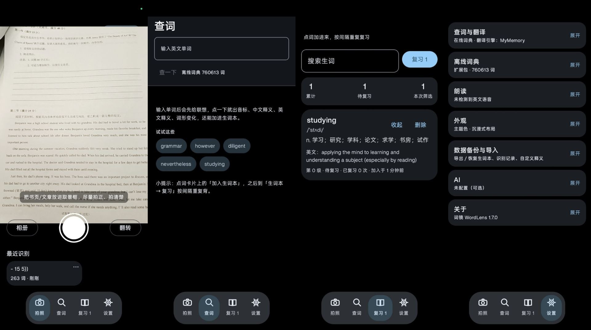
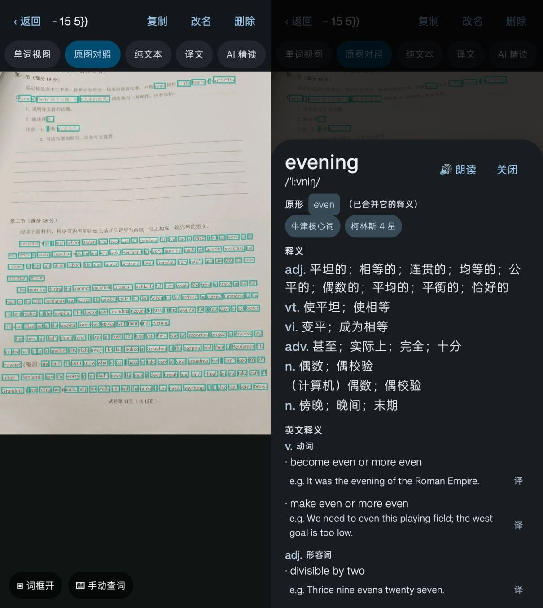

# 词镜 WordLens

**拍一页英文，点哪个词查哪个词。** Android · 离线优先 · 照片不出手机

[](https://github.com/AABCD233/WordLens/releases/latest)
[](https://github.com/AABCD233/WordLens/releases)
[](https://github.com/AABCD233/WordLens/issues)
[](LICENSE)

---

> [!WARNING]
> **AI 相关功能目前是实验性的。** 代码写完了、能编译，但**作者本人还没有完整测试过**
> （AI 详解 / AI 例句 / AI 搭配 / 整篇精读 / 用 AI 接口翻译这几项）。
> 不同模型和接口的返回格式差异很大，可能出现报错、答非所问、超时，或者**产生费用**。
> 请自备 API Key、谨慎使用；遇到问题欢迎提 Issue，那正是我在收集的东西。

## 下载安装

**到 [Releases](https://github.com/AABCD233/WordLens/releases) 下载最新的 `app-debug.apk`，点开安装即可。**

- 系统要求：Android 8.0 及以上（minSdk 26）
- 首次安装需要在系统里允许「安装未知来源应用」
- 从 **1.2.0 之前的版本**升级，需要先卸载旧版（签名换过，装不上是正常的）；1.2.0 之后都能直接覆盖升级

---

## 它是什么

拍照或选图 → 端侧 OCR 把文字切到「词」这一级 → 点任意单词，立刻出音标、中文释义、英文释义与例句、
词形变化、考试标签和原句，还能朗读、加进生词本。生词本按间隔重复自动安排复习。

**识别和查词都在本机完成**，断网也能用；照片只留在手机里，不上传。

---

## 截图

<p align="center">
  
</p>
<p align="center"><sub>拍照 → 识别 → 点词；查词页、生词本、设置（悬浮导航栏会随滚动收起）</sub></p>

<p align="center">
  
</p>
<p align="center"><sub>原图对照：词框可直接点、可缩放、可一键关掉；点词弹出释义卡，原形和词形变化都能点进去查</sub></p>

---

## 功能

| 页面 | 能做什么 |
|---|---|
| 📷 拍照 | 相机预览 / 拍照识别 / 相册选图（Photo Picker，不要存储权限）/ 前后摄切换；下方「最近识别」可回看、改名、删除 |
| 📖 阅读页 | 四种视图：**单词视图**（逐行可点）· **原图对照**（按词框命中，可双指缩放、拖动、开关词框）· **纯文本** · **译文**；还有 **AI 精读**（实验性）；可复制全文、改名、删除 |
| 🔍 查词 | 不拍照直接查，输入即联想；原形与词形变化都能点进去；OCR 认错字时也能用手动查词救回来 |
| 词卡 | 音标、中文释义（按词性分行）、英文释义与例句、双语例句、词形变化（可点）、考试标签、原句 + 朗读；可写**自定义释义**；可加入生词本。AI 详解 / 例句 / 搭配属于**实验性功能** |
| 📚 生词本 | 搜索、展开详情、删除；「复习 N」显示到期数量 |
| 复习 | Leitner 间隔重复：记得就升级（1/2/4/7/15/30 天），忘了回第 0 级、10 分钟后再出现 |
| ⚙️ 设置 | 查词来源、翻译引擎（6 种）、离线词典包（可下载全量包）、朗读、AI 接口、**数据备份与导入** |

### 哪些功能要联网，哪些不用

**完全离线**（断网、飞行模式都能用）：

| 功能 | 说明 |
|---|---|
| 拍照 / 相册识别 | ML Kit 端侧模型已打进 APK，不上传、不下载 |
| 离线查词 | 内置 11 万词，词形还原、原形合并都在本地 |
| 生词本 / 复习 | 本地 SQLite，间隔重复排期也在本地算 |
| 自定义释义 | 只存本机 |
| 原图对照缩放、词框开关 | 纯本地渲染 |
| 备份导出 / 导入 | 只读写你自己选的文件 |
| 系统语音朗读 | 用手机自带的 TTS 引擎（前提是装了英文语音包） |

**需要联网**（默认开着，都可以在设置里关掉）：

| 功能 | 走哪 | 发出去的内容 |
|---|---|---|
| 免费英文词典（英英释义 / 例句 / 发音 URL） | dictionaryapi.dev | 你点的那个单词 |
| 有道补中文 + 双语例句 | dict.youdao.com | 你点的那个单词 |
| 机器翻译兜底 | MyMemory / 百度 / 有道 / Azure / Google 之一 | 你点的那个单词，或整段原文（点「翻译全文」时） |
| 在线朗读 | dict.youdao.com/dictvoice | 要朗读的那句话 |
| AI 详解 / 例句 / 搭配 / 整篇精读 | 你自己配的 OpenAI 兼容接口 | 单词 + 那一句上下文（整篇精读就是全文） |
| 下载词典包 | GitHub Releases | 只是下载，不上传任何东西 |

两条底线：**照片永远不出手机**；在线功能失败时一律退回离线结果，不会让查词不可用。

### 查词的优先级（离线优先，断网可用）

```
1. 离线词典（内置 11 万词；点 studying 会自动按 study 查，并把原形条目一起合并）
2. 免费英文词典 dictionaryapi.dev   ← 补英英释义 / 例句 / 发音 URL
3. 有道在线词典（需手动开启）        ← 补中文释义 + 双语例句
4. 机器翻译（可选引擎）              ← 离线没收录时给一句中文
5. AI 接口（OpenAI 兼容）            ← 只在你点「AI 详解 / 例句 / 搭配 / 精读」时调用
```

第 2 步之后的任何一步失败都不影响使用，只是内容少一点；断网时词卡顶部会明确提示。

---

## 关于这个项目

- **本项目由 AI 构建。** 代码、文档、CI 配置、发版流程基本都是 AI（DeepSeek / Claude 等）写的，
  人负责提需求和测试。这点想先说清楚，免得你对代码风格或架构有别的预期。
- **还在开发初期。** 功能不完善、边界情况可能没覆盖、也可能有 bug。
- **AI 功能是实验性的。** 手头没有稳定的接口和额度，作者至今**没有完整测过**这条链路；
  界面、提示词、错误处理都可能需要按你的模型调整。非 AI 的查词、生词本、复习、备份这些是测过的。
  已知问题会记在 [Issues](https://github.com/AABCD233/WordLens/issues) 里。
- **欢迎 PR。** 修 bug、加功能、改文案、补文档都欢迎；提之前开个 Issue 说一声更容易对齐。
  真的只是随便用用也欢迎反馈问题，描述清楚「什么机型、什么操作、什么现象」就行。

### 一些技术选择

- Kotlin + Jetpack Compose，单模块 `:app`，minSdk 26
- OCR 用 ML Kit Text Recognition v2（bundled 模型，不依赖 Google Play 服务，离线可用）
- **故意不引** Room/KSP、Coil、OkHttp、kotlinx-serialization、Navigation、Hilt：
  在没人本地编译、全靠 CI 出包的条件下，注解处理器和第三方坐标是最容易让流水线变红的东西，
  而它们的功能这里用标准库几十行就能替代（`SQLiteOpenHelper`、`HttpURLConnection` + `org.json`、自写路由）

---

## 数据与隐私

- 图片只存在 App 私有目录（`files/documents/`），OCR 全程本地，**不上传**
- 只有你主动开启的在线查词 / 翻译 / AI 会发请求，内容仅是你点的那个词（AI 会附带那一句上下文）
- API Key 存在本机私有偏好文件里，不写日志、不进备份
- 备份导出的 JSON 只包含文字数据（生词本、识别记录、自定义释义），不含图片

---

## 给开发者


- 目录结构、词典构建、CI 说明都在 [`.github/workflows/build-apk.yml`](.github/workflows/build-apk.yml)
  和 [`data/dict/`](data/dict/) 里；PR 直接改代码，CI 会自动编译并校验签名。
- 离线词典：`python3 data/dict/build_dict.py`（数据源 [ECDICT](https://github.com/skywind3000/ECDICT)，MIT）
- 想自己装机试试：`./gradlew :app:assembleDebug`

---

## 常见问题

| 现象 | 处理 |
|---|---|
| 点词只有中文、没有英文例句 | 设置里打开「免费英文词典」；或打开「有道词典在线补中文」拿双语例句 |
| 识别不出文字 | 拍正、拍清楚、让一行字尽量占满屏宽；也可以切「原图对照」按词框点词，或用「手动查词」 |
| 某个词查不到 | 可能是 OCR 认错了。用「手动查词」敲正确的词；或在设置里下载全量词典包（76 万词） |
| 朗读没声音 | 系统缺英文 TTS 引擎：设置 → 无障碍 → 文字转语音，装一个 Google 文字转语音 |
| 覆盖安装报「签名不一致」 | 只有 1.2.0 之前的版本会这样，卸载旧版再装即可 |
| 想换个词库 | 设置 → 离线词典 → 下载官方全量包，或填自己的 `.db` / `.db.gz` 地址 |

---

## 致谢与许可

- 词典数据：[ECDICT](https://github.com/skywind3000/ECDICT)（MIT）
- 在线能力：dictionaryapi.dev、MyMemory、有道词典（均为各自服务方提供）
- 本项目代码：[MIT](LICENSE)
- 第三方数据与在线服务的许可：见 [THIRD-PARTY-NOTICES.md](THIRD-PARTY-NOTICES.md) 与 [data/dict/LICENSE.md](data/dict/LICENSE.md)
